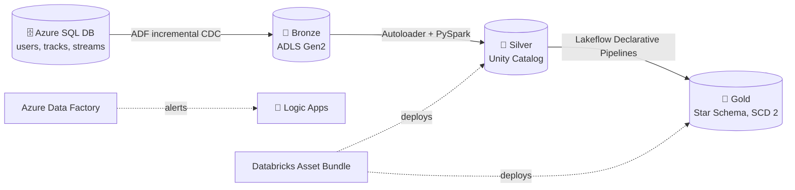
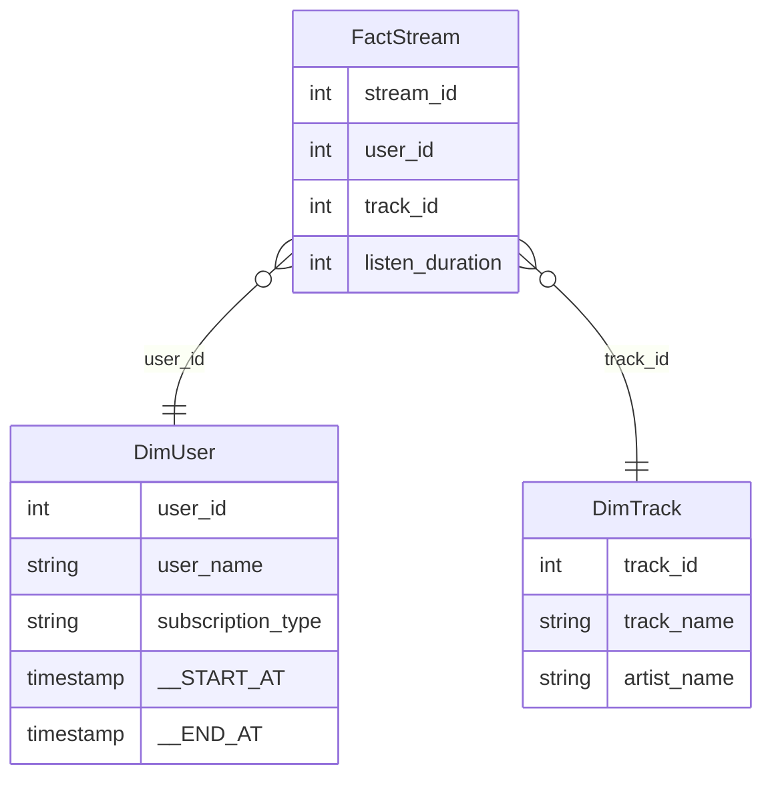

<div align="center">

# 🎧 WaveLake

### A music streaming lakehouse on Azure and Databricks

Streaming data (users, tracks and listening events) moves from **Azure SQL Database** into **ADLS Gen2** with change-aware incremental loads, then through **Databricks** into a **Star Schema** with SCD Type 2 history and built-in data quality rules.


</div>

---

## 📌 Overview

WaveLake models the data behind a music streaming app: who listens, what they listen to, and when. The goal was to build the full path from an operational database to analytics tables, and to make every step incremental, reusable and safe to rerun.

## 🏗️ Architecture



## ✨ Highlights

**Ingestion with Azure Data Factory**
- A single parameterized pipeline loops over every source table with `ForEach`, so new tables need configuration, not new pipelines.
- Change-aware loads: a `Lookup` reads the last CDC timestamp, `Copy` pulls only newer rows, `Get Metadata` checks the output, and `If Condition` either updates the CDC marker or deletes empty files.
- A `Web` activity calls a **Logic App** to send alerts.

**Transformation with Databricks**
- **Silver:** PySpark with **Autoloader** for incremental file ingestion, governed by **Unity Catalog**, with shared helper functions in `utils/`.
- **Jinja templates** generate reusable SQL instead of repeating the same joins.
- **Gold:** **Lakeflow Declarative Pipelines** build `DimUser`, `DimTrack`, `DimDate` and `FactStream`. Expectations drop invalid rows (for example, null keys), and `auto CDC` flows keep **SCD Type 2** history.
- Packaged as a **Databricks Asset Bundle** with separate `dev` and `prod` targets, so the gold pipeline is deployed as code.

## ⭐ Gold data model



`DimDate` completes the model as a calendar dimension. `DimUser` and `DimTrack` keep full history (SCD Type 2), and `FactStream` is upserted on `stream_id`.

## 📁 Repository structure

```
.
├── pipeline/              # ADF: incremental_ingestion, incremental_loop
├── dataset/               # parameterized SQL, Parquet and JSON datasets
├── linkedService/         # Azure SQL, ADLS Gen2
└── mybundle_spotify/      # Databricks Asset Bundle
    ├── src/silver/        # silver dimensions (PySpark + Autoloader)
    ├── src/gold/dlt/      # Lakeflow pipelines: dims, fact, SCD 2
    ├── Jinja/             # Jinja-templated SQL
    ├── utils/             # shared transformations
    ├── resources/         # job + pipeline definitions
    └── databricks.yml     # bundle targets (dev / prod)
```

## 🚀 Deploy it yourself

1. Create Azure SQL Database, ADLS Gen2 (`bronze`, `silver`, `gold`), Azure Data Factory and a Databricks workspace with Unity Catalog.
2. Connect ADF to this repository through **Git configuration** and update the linked services with your own resources (keep secrets in **Azure Key Vault**).
3. Run `incremental_loop` to land the source tables in bronze.
4. Deploy the Databricks side with the bundle:

   ```bash
   cd mybundle_spotify
   databricks bundle validate
   databricks bundle deploy -t dev
   databricks bundle run wavelake_gold -t dev
   ```

## 🧠 What I learned

- Building incremental ingestion that survives reruns and empty loads.
- Splitting responsibilities: ADF moves data, Databricks transforms it.
- Declaring data quality and SCD Type 2 directly in Lakeflow pipelines.
- Packaging Databricks work as code with Asset Bundles.

---

<div align="center">

**Mohammed Alharbi** · Data Engineer

[Portfolio](https://devmohammedalharbi.github.io) · [LinkedIn](https://linkedin.com/in/mohammed-alharbi-1606a7388) · [GitHub](https://github.com/DevMohammedAlharbi)

</div>
